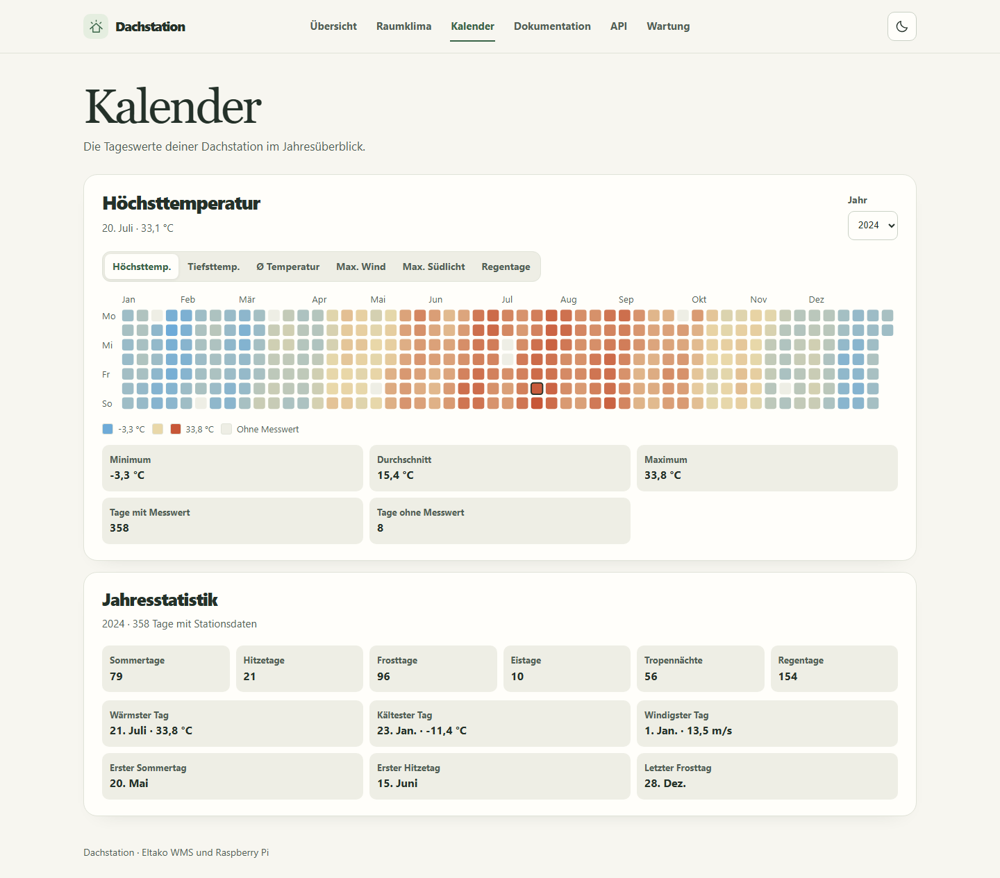
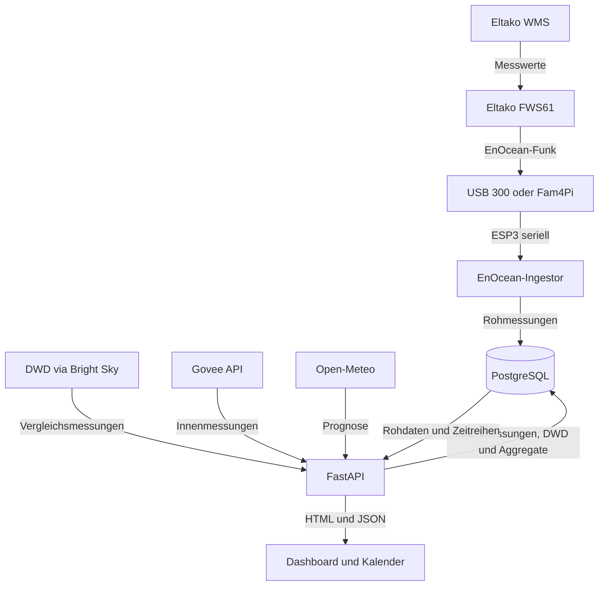

# EnOcean Wetterstation

EnOcean Wetterstation ist ein selbst gehostetes Wetter-Dashboard für den Raspberry Pi. Es empfängt die EnOcean-Funktelegramme eines **Eltako Wetterdaten-Multisensors WMS** über ein kompatibles Sendemodul und einen seriellen EnOcean-Empfänger. Die Messwerte werden in PostgreSQL gespeichert und im Browser als Live-Übersicht, Zeitreihen und Jahreskalender angezeigt.

## Funktionen

- **EnOcean-Empfang** über ESP3. Der Ingestor filtert nach der konfigurierten Sender-ID und dekodiert die beiden 4BS-Telegramme des Eltako-Funkmoduls.
- **Aktuelle Messwerte** für Außentemperatur, Windgeschwindigkeit, Dämmerungshelligkeit und Helligkeit nach Osten, Süden und Westen. Die Regenkarte zeigt den Zustand des Nass-/Trockensensors sowie Zeitpunkt und beobachtete Dauer des letzten Regenereignisses.
- **Historische Zeitreihen** für 24 Stunden, 7, 30 und 365 Tage sowie frei wählbare Zeiträume. Das Außentemperaturdiagramm kann DWD-Vergleichswerte von Bright Sky einblenden. Rohmessungen lassen sich als CSV exportieren.
- **Wetterprognose** von Open-Meteo am konfigurierten Standort. Standardmäßig werden zwölf Stunden mit Wetterzustand, Temperatur und Niederschlagswahrscheinlichkeit angezeigt.
- **Automatische Aktualisierung** der Übersichtsseite. Aktuelle Messwerte und der 24-Stunden-Verlauf werden alle 60 Sekunden neu geladen. Empfangsstatus und Prognose haben eigene Intervalle.
- **Jahreskalender als Heatmap** für Temperatur, Wind, Helligkeit und Regentage mit Tagesdetails, Extremwerten und Kennzahlen wie Frost- und Hitzetagen.
- **Govee-Raumklima** für Thermometer, Hygrometer und smarte Thermostate, die ihre gemessene Temperatur oder Luftfeuchte über die Govee-API bereitstellen. Die Integration liest Messwerte aus. Je nach Gerät und Datenlage zeigt das Dashboard Temperaturverlauf, Feuchte, Taupunkt und Hitzeindex.

## Screenshots

Die **Übersicht** zeigt aktuelle Außenmessungen, Prognose und Zeitreihen. Alle sichtbaren Werte und Gerätenamen sind frei erfunden.


Der **Kalender** zeigt die höchste Temperatur je Tag und die Jahresstatistik anhand synthetischer Messwerte.



## Hardware

| Komponente | Anforderung |
| --- | --- |
| Raspberry Pi | Ein Modell, auf dem Raspberry Pi OS mit Python ab 3.10 und PostgreSQL ab 14 laufen. Ein Pi 3B+ genügt für das Referenzsetup. Raspberry Pi OS Lite (64 Bit) ist eine passende Basis für Modelle mit 64-Bit-Unterstützung. |
| Zubehör für den Pi | Passendes Netzteil, microSD-Karte oder SSD und LAN oder WLAN. Je nach Pi-Modell ist für den Stick ein USB-Adapter nötig. |
| EnOcean-Empfänger | ESP3-fähiger USB-Stick, z. B. **EnOcean USB 300 (868 MHz)** für Europa, oder eine serielle GPIO-Platine wie **Fam4Pi**. Empfänger und Sender müssen im selben Frequenzband arbeiten. |
| Wetterstation | **Eltako WMS** mit einem passenden Funk-Wetterdaten-Sendemodul, z. B. **FWS61-24V DC**, sowie der zum Aufbau passenden 24-V-Versorgung und Verkabelung. Das Sendemodul stellt die EnOcean-Profile A5-13-01 und A5-13-02 bereit. |
| Optional für Innenmesswerte | Govee-Gerät mit per API abrufbaren Messwerten, ein Govee-Konto und ein API-Schlüssel. |

[Herstellerangaben zu Eltako WMS](https://www.eltako.com/de/service/fragen-und-antworten/) · [FWS61 bei der EnOcean Alliance](https://www.enocean-alliance.org/product/eltako_fws61/) · [EnOcean USB 300](https://www.enocean.com/de/produkt/usb-300/)

## Installation

Die [Schritt-für-Schritt-Anleitung](DEPLOY.md#neuinstallation-auf-dem-raspberry-pi) führt von Raspberry Pi OS über USB- bzw. GPIO-Einrichtung und Sender-ID-Ermittlung bis zum ersten Aufruf des Dashboards. Sie enthält auch die [optionale SQLite-Migration](DEPLOY.md#optionale-sqlite-migration) und Hinweise für [bestehende Installationen](DEPLOY.md#bestehende-installation-aktualisieren).

Die Anwendung liefert eine lesende Weboberfläche und API ohne integrierte Anmeldung. Für den Betrieb sind ein vertrauenswürdiges Netz oder ein Reverse Proxy mit Zugriffsschutz vorgesehen. Zugangsdaten, Sender-ID und Standort werden auf dem Pi in der lokalen `.env` gesetzt.

## Datenfluss



FastAPI liest aus PostgreSQL und bildet Stunden- und Tagesaggregate für längere Zeiträume. Der Browser ruft alle Daten beim Backend ab. Open-Meteo-Prognosen liegen in einem gemeinsamen Zwischenspeicher im Backend.

| Pfad | Inhalt |
| --- | --- |
| `ingestor/` | Serieller ESP3-Empfang und Dekodierung |
| `backend/` | FastAPI, optionale Integrationen und Auswertungen |
| `db/` | PostgreSQL-Schema |
| `frontend/` | Browseroberfläche, Diagramme und lokale Schriftarten |
| `deploy/` | systemd-Dienste und optionales PostgreSQL-Tuning |
| `scripts/` | Installation der Diagrammbibliothek, Migration und Wartung |

## Tests

Mit installierten Abhängigkeiten aus dem Projektordner ausführen.

```bash
cd backend
../venv/bin/python -m unittest discover -s ../tests -v
```

Mit `TEST_DATABASE_URL` für eine separate Testdatenbank werden auch die PostgreSQL-Tests für Regenereignisse und Rollups ausgeführt.

## Lizenz und Datenquellen

Der Projektcode steht unter der [MIT-Lizenz](LICENSE). Copyright © 2026 beilo1.

[Apache ECharts](https://echarts.apache.org/) (Apache-2.0) wird bei der Installation bezogen und lokal ausgeliefert. Die eingebundenen Schriften [Fraunces](frontend/vendor/fonts/fraunces.txt) und [Plus Jakarta Sans](frontend/vendor/fonts/plus-jakarta-sans.txt) stehen unter der SIL Open Font License 1.1.

Wetterprognose von [Open-Meteo](https://open-meteo.com/en/docs) ([CC BY 4.0](https://creativecommons.org/licenses/by/4.0/)). DWD-Vergleichswerte vom [Deutschen Wetterdienst über Bright Sky](https://brightsky.dev/).
