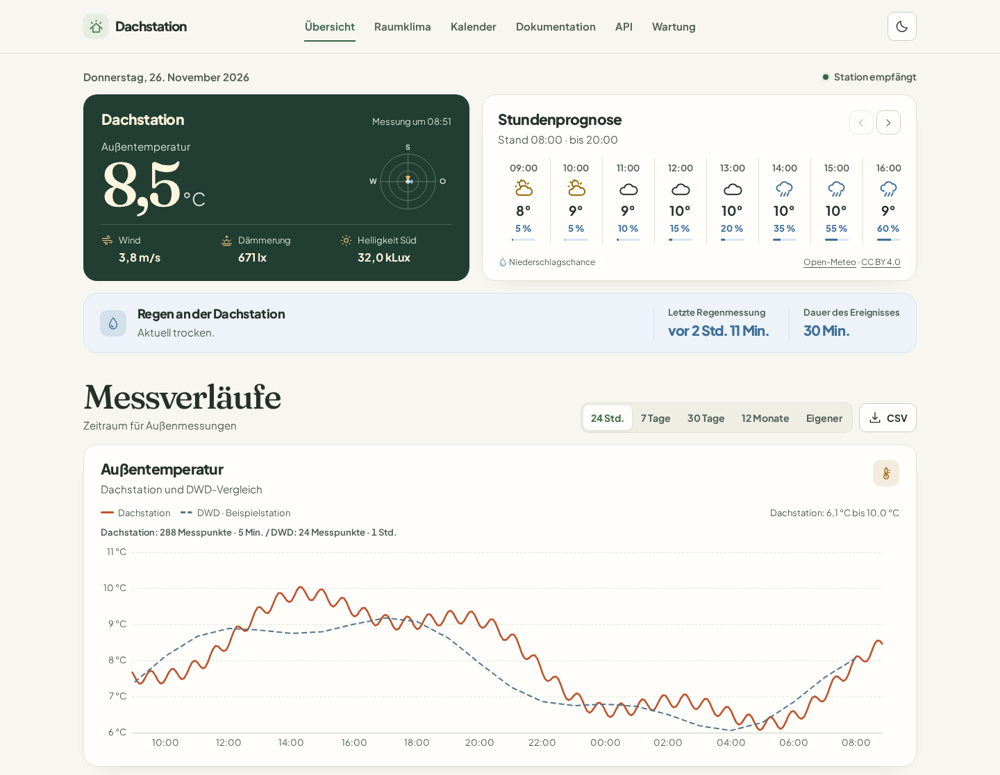
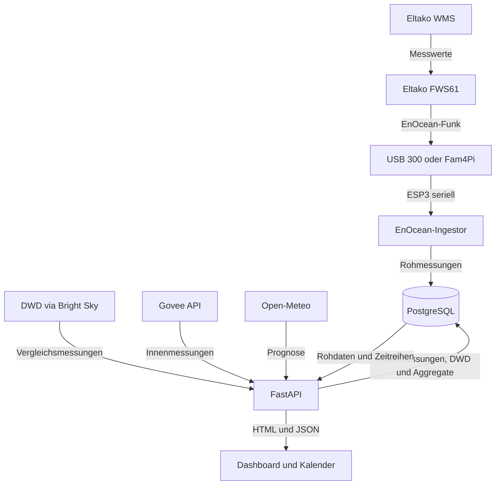

# EnOcean Wetterstation

EnOcean Wetterstation ist ein selbst gehostetes Wetter-Dashboard für den Raspberry Pi. Es empfängt die EnOcean-Funktelegramme eines **Eltako Wetterdaten-Multisensors WMS** über ein kompatibles Sendemodul und einen seriellen EnOcean-Empfänger. Die Messwerte werden in PostgreSQL gespeichert und im Browser als Live-Übersicht, Zeitreihen und Jahreskalender angezeigt.

## Funktionen

- **EnOcean-Empfang** über ESP3. Der Ingestor filtert nach der konfigurierten Sender-ID und dekodiert die beiden 4BS-Telegramme des Eltako-Funkmoduls.
- **Aktuelle Messwerte** für Außentemperatur, Windgeschwindigkeit, Dämmerungshelligkeit und Helligkeit nach Osten, Süden und Westen. Die Regenkarte zeigt den Zustand des Nass-/Trockensensors sowie Zeitpunkt und beobachtete Dauer des letzten Regenereignisses.
- **Historische Zeitreihen** für 24 Stunden, 7, 30 und 365 Tage sowie frei wählbare Zeiträume. Das Außentemperaturdiagramm kann DWD-Vergleichswerte von Bright Sky einblenden. Rohmessungen lassen sich als CSV exportieren.
- **Wetterprognose** von Open-Meteo am konfigurierten Standort. Standardmäßig werden zwölf Stunden mit Wetterzustand, Temperatur und Niederschlagswahrscheinlichkeit angezeigt.
- **Automatische Aktualisierung** der Übersichtsseite. Aktuelle Messwerte und der 24-Stunden-Verlauf werden alle 60 Sekunden neu geladen. Empfangsstatus und Prognose haben eigene Intervalle.
- **Jahreskalender als Heatmap** für Temperatur, Wind, Helligkeit und Regentage mit Tagesdetails, Extremwerten und Kennzahlen wie Frost- und Hitzetagen.
- **Govee-Raumklima** für Thermometer, Hygrometer und smarte Thermostate, die ihre gemessene Temperatur oder Luftfeuchte über die Govee-API bereitstellen. Die Integration liest Messwerte aus. Je nach Gerät und Datenlage zeigt das Dashboard Temperaturverlauf, Feuchte, Taupunkt und Hitzeindex.

## Screenshots

Die **Übersicht** zeigt aktuelle Außenmessungen, Prognose und Zeitreihen. Alle sichtbaren Werte und Gerätenamen sind frei erfunden.



Der **Kalender** zeigt die höchste Temperatur je Tag und die Jahresstatistik anhand synthetischer Messwerte.


## Hardware

| Komponente | Anforderung |
| --- | --- |
| Raspberry Pi | Ein Modell, auf dem Raspberry Pi OS mit Python ab 3.10 und PostgreSQL ab 14 laufen. Ein Pi 3B+ genügt für das Referenzsetup. Raspberry Pi OS Lite (64 Bit) ist eine passende Basis für Modelle mit 64-Bit-Unterstützung. |
| Zubehör für den Pi | Passendes Netzteil, microSD-Karte oder SSD und LAN oder WLAN. Je nach Pi-Modell ist für den Stick ein USB-Adapter nötig. |
| EnOcean-Empfänger | ESP3-fähiger USB-Stick, z. B. **EnOcean USB 300 (868 MHz)** für Europa, oder eine serielle GPIO-Platine wie **Fam4Pi**. Empfänger und Sender müssen im selben Frequenzband arbeiten. |
| Wetterstation | **Eltako WMS** mit einem passenden Funk-Wetterdaten-Sendemodul, z. B. **FWS61-24V DC**, sowie der zum Aufbau passenden 24-V-Versorgung und Verkabelung. Das Sendemodul stellt die EnOcean-Profile A5-13-01 und A5-13-02 bereit. |
| Optional für Innenmesswerte | Govee-Gerät mit per API abrufbaren Messwerten, ein Govee-Konto und ein API-Schlüssel. |

[Herstellerangaben zu Eltako WMS](https://www.eltako.com/de/service/fragen-und-antworten/) · [FWS61 bei der EnOcean Alliance](https://www.enocean-alliance.org/product/eltako_fws61/) · [EnOcean USB 300](https://www.enocean.com/de/produkt/usb-300/)

## Installation

Die [Schritt-für-Schritt-Anleitung](DEPLOY.md#neuinstallation-auf-dem-raspberry-pi) führt von Raspberry Pi OS über USB- bzw. GPIO-Einrichtung und Sender-ID-Ermittlung bis zum ersten Aufruf des Dashboards. Sie enthält auch die [optionale SQLite-Migration](DEPLOY.md#optionale-sqlite-migration) und Hinweise für [bestehende Installationen](DEPLOY.md#bestehende-installation-aktualisieren).

Die Anwendung liefert eine lesende Weboberfläche und API ohne integrierte Anmeldung. Für den Betrieb sind ein vertrauenswürdiges Netz oder ein Reverse Proxy mit Zugriffsschutz vorgesehen. Zugangsdaten, Sender-ID und Standort werden auf dem Pi in der lokalen `.env` gesetzt.

## Datenfluss



FastAPI liest aus PostgreSQL und bildet Stunden- und Tagesaggregate für längere Zeiträume. Der Browser ruft alle Daten beim Backend ab. Open-Meteo-Prognosen liegen in einem gemeinsamen Zwischenspeicher im Backend.

| Pfad | Inhalt |
| --- | --- |
| `ingestor/` | Serieller ESP3-Empfang und Dekodierung |
| `backend/` | FastAPI, optionale Integrationen und Auswertungen |
| `db/` | PostgreSQL-Schema |
| `frontend/` | Browseroberfläche, Diagramme und lokale Schriftarten |
| `deploy/` | systemd-Dienste und optionales PostgreSQL-Tuning |
| `scripts/` | Installation der Diagrammbibliothek, Migration und Wartung |

## EnOcean-Datagramme

Der Eltako WMS liefert seine Messwerte per Leitung an das FWS61. Das FWS61 sendet zwei 4BS-Funktelegramme mit derselben Sender-ID (Eltako-Format für A5-13-01 und A5-13-02). Ein EnOcean-USB-Stick oder eine Fam4Pi-Platine empfängt sie und gibt sie als ESP3-Rahmen über die serielle Schnittstelle an den Raspberry Pi weiter. Der Ingestor öffnet `SERIAL_PORT` mit standardmäßig 57.600 Baud (8 Datenbits, keine Parität, 1 Stoppbit).

### ESP3-Rahmen im Beispiel

Senkrechte Striche markieren die Feldgrenzen. Die Sender-ID `A1 B2 C3 D4` und alle Messwerte sind erfunden.

```text
Teil 1 · Wetter:     55 | 00 0A 07 01 | EB | A5 40 80 12 1A A1 B2 C3 D4 00 | 01 FF FF FF FF 3C 00 | B9
Teil 2 · Helligkeit: 55 | 00 0A 07 01 | EB | A5 36 9C 24 28 A1 B2 C3 D4 00 | 01 FF FF FF FF 3C 00 | 2D
```

| Feld | Hex | Bedeutung |
| --- | --- | --- |
| Sync | `55` | Beginn des seriellen ESP3-Rahmens. |
| Header | `00 0A 07 01` | 10 Byte DATA, 7 Byte OPTIONAL_DATA, Pakettyp 01 (RADIO_ERP1). |
| Header-CRC | `EB` | CRC-8 über die vier Header-Bytes. |
| DATA | `A5 · DB3 DB2 DB1 DB0 · A1 B2 C3 D4 · 00` | 4BS-Typ A5, vier Wetterdatenbytes, vier Byte Sender-ID, ein Statusbyte. |
| OPTIONAL_DATA | `01 FF FF FF FF 3C 00` | Empfangsmetadaten. Im Beispiel Subtelegramm-Zähler 1, Broadcast-Ziel, RSSI −60 dBm, Security Level 0. |
| Daten-CRC | `B9 / 2D` | CRC-8 über DATA und OPTIONAL_DATA, je nach Telegramm. |

<details>
<summary>Vollständige Rahmen in Binärdarstellung</summary>

```text
Teil 1
01010101 | 00000000 00001010 00000111 00000001 | 11101011 | 10100101 01000000 10000000 00010010 00011010 10100001 10110010 11000011 11010100 00000000 | 00000001 11111111 11111111 11111111 11111111 00111100 00000000 | 10111001

Teil 2
01010101 | 00000000 00001010 00000111 00000001 | 11101011 | 10100101 00110110 10011100 00100100 00101000 10100001 10110010 11000011 11010100 00000000 | 00000001 11111111 11111111 11111111 11111111 00111100 00000000 | 00101101
```

</details>

### Datenbytes und Messwerte

```text
Teil   Hex          Bits (DB3 → DB0)
1      40 80 12 1A  01000000 10000000 00010010 00011010
2      36 9C 24 28  00110110 10011100 00100100 00101000
```

Die Bits sind pro Byte vom höchstwertigen zum niederwertigsten Bit dargestellt (`b7…b0`). `x` ist der vorzeichenlose Dezimalwert des Datenbytes. Im ersten Teil unterscheiden sich `1A` (`00011010`, nass) und `18` (`00011000`, trocken) in Bit `b1`. Der Ingestor vergleicht das vollständige `DB0`. `28` (`00101000`) kennzeichnet den zweiten Teil.

| Position | Messgröße | Hex | Dezimal | Feld in `readings` | Umrechnung | Beispielwert |
| --- | --- | --- | --- | --- | --- | --- |
| 1 · DB3 | Dämmerungshelligkeit | `40` | 64 | `twilight_lux` | x × 1000 / 255 | 250,98 lx |
| 1 · DB2 | Außentemperatur | `80` | 128 | `temperature_c` | x × 120 / 255 − 40 | 20,24 °C |
| 1 · DB1 | Windgeschwindigkeit | `12` | 18 | `wind_ms` | x × 70 / 255 | 4,94 m/s |
| 1 · DB0 | Regen und Kennung | `1A` | 26 | `rain` | 1A → true · 18 → false | Regen (nass) |
| 2 · DB3 | Helligkeit West | `36` | 54 | `west_klux` | x × 150 / 255 | 31,76 kLux |
| 2 · DB2 | Helligkeit Süd | `9C` | 156 | `south_klux` | x × 150 / 255 | 91,76 kLux |
| 2 · DB1 | Helligkeit Ost | `24` | 36 | `east_klux` | x × 150 / 255 | 21,18 kLux |
| 2 · DB0 | Kennung für Teil 2 | `28` | 40 | – | 28 → Helligkeitsteil | Teil 2 |

### Empfang, Filterung und Speicherung

1. Der ESP3-Reader sucht `55`, liest Längen und Pakettyp aus dem Header und trennt `DATA` von `OPTIONAL_DATA`. Er liest beide CRC-Bytes mit und überspringt sie bei der Auswertung.
2. Der Ingestor akzeptiert `RADIO_ERP1` (`01`) mit mindestens zehn Datenbytes und `R-ORG = A5`. Er liest `DATA[1:5]` als `DB3…DB0` und `DATA[5:9]` als Sender-ID in Großbuchstaben. Die ID muss zur lokal gesetzten `SENSOR_ID` passen. Status und Empfangsmetadaten bleiben außerhalb der Messwerte.
3. Der Ingestor speichert den letzten empfangenen Teil jedes Typs pro Sender. Beim ersten vollständigen Paar und bei jedem späteren passenden Telegramm schreibt er eine Zeile mit beiden Teilen, `sensor_id` und dem UTC-Zeitpunkt des Pi in `readings`. Bis ein neuer Teil eintrifft, wird dessen zuletzt empfangener Wert weiterverwendet. `/api/latest` liefert daraus die letzte Messung. Zeitreihen und Kalender verwenden die Messhistorie.

Die Implementierung steht im [ESP3-Reader](ingestor/esp3.py) und im [Ingestor](ingestor/enocean_ingestor.py).

[Eltako · FWS61-Telegramme](https://www.eltako.com/fileadmin/downloads/en/_main_catalogue/Gesamt-Katalog_ChT_gb_highRes.pdf) · [EnOcean · ESP3, Abschnitte 1 und 2.1](https://www.enocean.com/wp-content/uploads/Knowledge-Base/EnOceanSerialProtocol3-1.pdf)

## Tests

Mit installierten Abhängigkeiten aus dem Projektordner ausführen.

```bash
cd backend
../venv/bin/python -m unittest discover -s ../tests -v
```

Mit `TEST_DATABASE_URL` für eine separate Testdatenbank werden auch die PostgreSQL-Tests für Regenereignisse und Rollups ausgeführt.

## Lizenz und Datenquellen

Der Projektcode steht unter der [MIT-Lizenz](LICENSE). Copyright © 2026 beilo1.

[Apache ECharts](https://echarts.apache.org/) (Apache-2.0) wird bei der Installation bezogen und lokal ausgeliefert. Die eingebundenen Schriften [Fraunces](frontend/vendor/fonts/fraunces.txt) und [Plus Jakarta Sans](frontend/vendor/fonts/plus-jakarta-sans.txt) stehen unter der SIL Open Font License 1.1.

Wetterprognose von [Open-Meteo](https://open-meteo.com/en/docs) ([CC BY 4.0](https://creativecommons.org/licenses/by/4.0/)). DWD-Vergleichswerte vom [Deutschen Wetterdienst über Bright Sky](https://brightsky.dev/).
